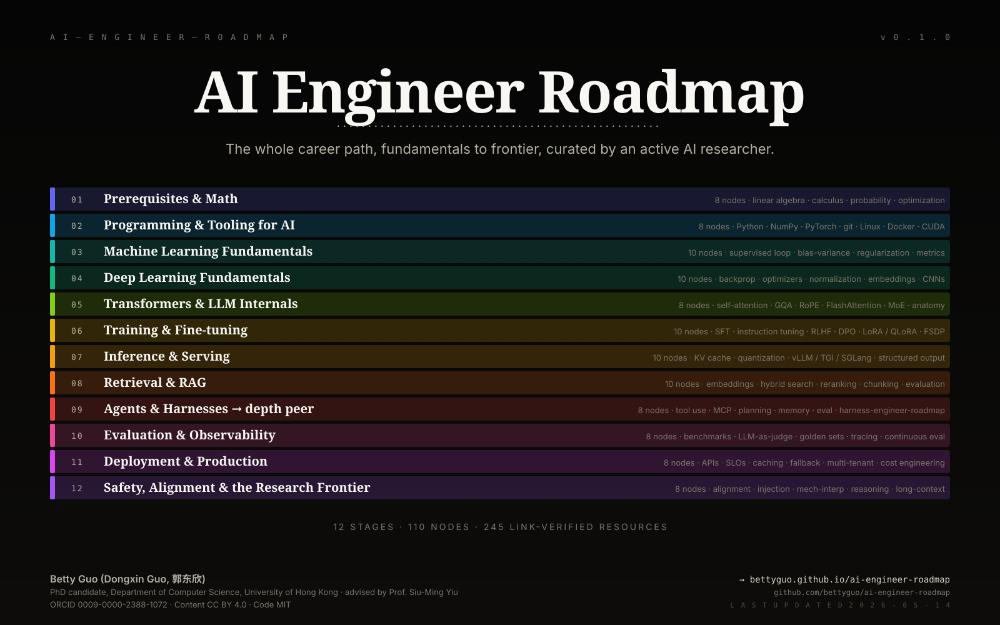

# AI Engineer Roadmap

> An interactive roadmap for becoming — and growing as — an AI engineer.
> The whole career path, from math and programming to the research frontier,
> with curated and link-verified resources on every node. Curated by an
> active AI researcher.

  

  The image above is a structural overview. The <em>interactive</em> diagram — pannable, zoomable, click-any-node for resources — lives at the live site below.

  <b><a href="https://bettyguo.github.io/ai-engineer-roadmap/">→ Open the interactive roadmap</a></b>

---

## Why this exists

AI engineering moves so fast that no single course, blog post, or Twitter
thread holds the whole picture. The result is the most common anxiety in
the industry right now: *am I learning the right things? am I about to
fall behind?* This roadmap is the picture: **12 stages, 122 nodes, 276
link-verified resources**, every stage of the career path, every required
idea, the best one or two resources for each, kept current.

It is curated by **one person who is actively working in the field**, not
crowdsourced into a brand-flavored mush. That single editorial voice is
the whole point — you should be able to trust the picks.

### Why standalone, vs `roadmap.sh/ai-engineer`?

`roadmap.sh/ai-engineer` is a great page inside a 354k-star platform —
but it is deliberately scoped to **applied** AI (using pre-trained
models), not the full career path; it is community-edited within a
multi-topic brand; it cannot be cited, forked, or branded as a
standalone reference. This roadmap is the standalone alternative:
**end-to-end** (math through frontier, not applied-only),
**single-curator** (one editorial voice, a real name behind the picks),
and **citable** (CC BY 4.0 + ORCID + a `CITATION.cff`). Different game,
different win condition.

## How to use this roadmap

The interactive site is the primary view: pan and zoom the graph, click
any node to open a resource panel. The repo holds the structured source
of truth (`roadmap-data/`) and a static markdown view (`content/`) for
SEO, accessibility, and offline reading.

Three reading paths — each one is a curated subset, not the full 122-node
map. See **[docs/READING_PATHS.md](docs/READING_PATHS.md)** for the
node-by-node plan, time budgets, and "one project to lock it in" per path:

- **CS student or new grad pivoting into AI** — read top-to-bottom; the
  core nodes in every stage are the whole path. 6–10 months @ 15 hrs/week.
- **Working software engineer transitioning in** — skim Stages 1–4 to
  self-locate, then focus on 5–11. 8–12 weeks @ 10 hrs/week.
- **Working AI engineer staying current** — go to the
  [**Recently added**](content/RECENTLY_ADDED.md) view and the **Frontier**
  stage; both are refreshed monthly. 2–4 hrs/week, indefinitely.

Other companion docs:

- **[docs/FAQ.md](docs/FAQ.md)** — the questions every reader asks. How
  long does this take? Do I need a PhD? Can I skip the math? Why not
  just use roadmap.sh? How is the roadmap maintained?
- **[docs/GLOSSARY.md](docs/GLOSSARY.md)** — A–Z terminology lookup, each
  term pointing to the node where it's developed.

## Scope

This is the **breadth** roadmap — the whole career path, end to end:

1. Prerequisites & Math
2. Programming & Tooling for AI
3. Machine Learning Fundamentals
4. Deep Learning Fundamentals
5. Transformers & LLM Internals
6. Training & Fine-tuning
7. Inference & Serving
8. Retrieval & RAG
9. Agents & Harnesses *(summary stage — see hand-off below)*
10. Evaluation & Observability
11. Deployment & Production
12. Safety, Alignment & the Research Frontier

**Stage 9 is deliberately a summary.** Agents and harnesses are a full
craft of their own; for the depth dive, see the peer roadmap
**[harness-engineer-roadmap](https://github.com/bettyguo/harness-engineer-roadmap)**.

## The constellation

These four repos are standalone equals — peers, not parent-and-children.
Pick the one that matches what you're trying to do:

| Repo | What it is | When you want it |
|---|---|---|
| **ai-engineer-roadmap** *(this repo)* | The whole-field breadth roadmap. | "Where does this fit in the picture?" |
| **[harness-engineer-roadmap](https://github.com/bettyguo/harness-engineer-roadmap)** | The depth roadmap for the Agents & Harnesses stage. | "I want to specialize in building harnesses." |
| **[llm-interview-prep](https://github.com/bettyguo/llm-interview-prep)** | AI-engineer interview preparation. | "I am about to interview." |
| **[build-your-own-ai](https://github.com/bettyguo/build-your-own-ai)** | Hands-on "build it yourself" companion. | "I want to learn by building." |

## How this roadmap is maintained

- **Monthly pulse:** a `CHANGELOG.md` entry summarizing what was added,
  revised, or removed, and a brief frontier review.
- **Weekly:** an automated link-check (CI cron). Broken links are opened
  as issues.
- **Recently added view:** auto-generated from the data on every build —
  see [content/RECENTLY_ADDED.md](content/RECENTLY_ADDED.md) for the
  last 90 days of additions, sorted newest first.
- **PR-friendly:** every node has a clear contribution path. See
  [CONTRIBUTING.md](CONTRIBUTING.md).

## Curator

**Betty Guo** ([Dongxin Guo](https://bettyguo.github.io)), PhD candidate in Computer Science at [The University of Hong Kong](https://www.cs.hku.hk/), advised by [Prof. Siu-Ming Yiu](https://www.cs.hku.hk/people/academic-staff/smyiu).

## Licensing

- **Content** (the taxonomy, descriptions, annotations, resource picks):
  [CC BY 4.0](LICENSE-CONTENT).
- **Code** (renderer, schemas, tooling): [MIT](LICENSE).

Citing in academic work: see [CITATION.cff](CITATION.cff).

## Star history

## Contributing

Most welcome contributions:

1. **Suggest a better resource for an existing node** — open a PR adding
   the resource entry to the relevant `roadmap-data/stages/*.json`.
2. **Flag a broken or wrong resource** — open an issue (the
   `fix-resource` template).
3. **Propose a new node** — open an issue (the `add-node` template) with
   a 1-paragraph rationale and 1–3 candidate resources.

All PRs pass through `tools/validate_data.py` and `tools/linkcheck.py` in
CI. See [CONTRIBUTING.md](CONTRIBUTING.md) for the full rules.
